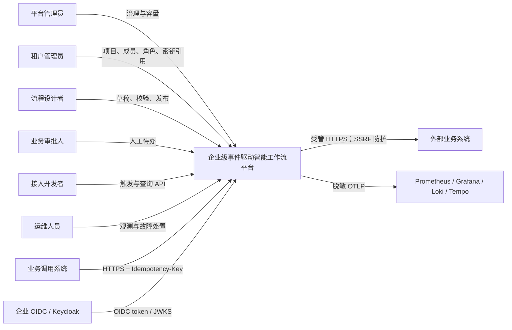
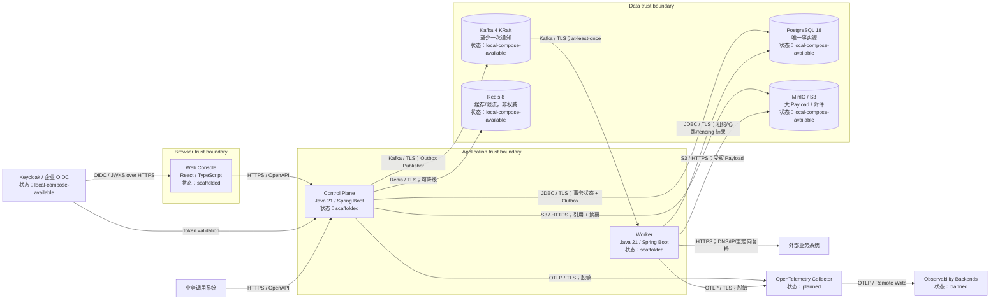
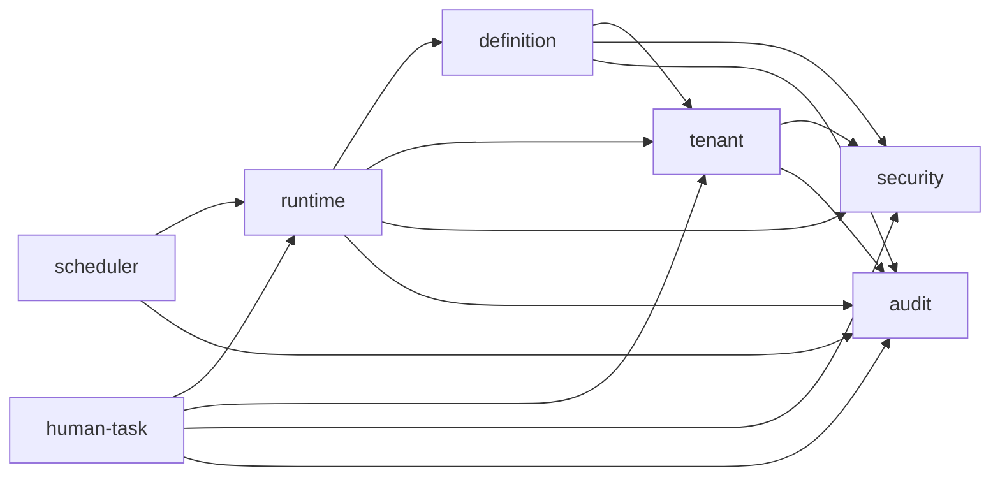

# 系统上下文、容器与模块依赖视图

- 状态：Accepted
- 日期：2026-07-30
- 对应任务：G2-01
- 机器模型：`config/architecture/model.json`
- 校验命令：`pnpm architecture:verify`、`pnpm architecture:test`

本文使用可版本管理的 Mermaid 表达 C4 Level 1/2 和控制面模块依赖。图描述目标边界，并通过“部署状态”区分已搭骨架、本地 Compose 已提供和后续计划，不能把图中的计划组件当作已实现能力。

## 1. C4 Level 1：系统上下文



系统边界内负责流程定义、持久化执行、恢复、租户治理和观测；企业 IdP、调用方、被调用业务系统和遥测后端位于外部信任边界。平台只承诺内部单次有效状态推进，对外部副作用提供至少一次执行和业务幂等辅助，不承诺任意外部接口 exactly-once。

## 2. C4 Level 2：容器与协议



关键边界：

- PostgreSQL 是实例、节点、attempt、调度、租约、幂等、审计和 Outbox 的唯一事实源。
- Kafka 消息只表示“数据库中可能有工作”；Worker 必须成功领取数据库租约后才能执行。
- Redis 丢失不能造成流程状态丢失；MinIO 保存大对象，PostgreSQL 保存受权引用和摘要。
- Web Console 只能调用 OpenAPI，不能直连数据库或读取后端内部模型。
- Worker 与 Control Plane 独立部署、独立扩缩容，且不能形成编译依赖。

## 3. Control Plane 模块依赖图

箭头表示“调用方允许编译依赖被调用方”。图必须无环，跨模块只能访问目标根包公开 application API。



机器校验会把该依赖模型与七个 `package-info.java` 的 `@ModuleBoundary` 声明逐项对比；任何缺失、额外依赖或环都会失败。异步反向通知使用版本化事件，同步跨模块协作只允许根包 application API；禁止跨模块访问内部包、Repository 或直接更新对方数据。

## 4. 数据所有权

以下是 G2-01 的能力级所有权基线；G2-03 会在 ER 评审时锁定列、外键、索引、RLS 和迁移归属。单一 owner 不等于只有一个进程可写：Worker 对 runtime 数据只有文档化、带租户/状态/version/fencing 条件的最小写权限。

| 数据集 | Owner | 授权写入者 | 访问规则 |
|---|---|---|---|
| tenant, project, membership, role, role_binding, quota_usage | tenant | tenant | 其他模块只通过 tenant application API 获取授权结论 |
| workflow_definition, workflow_version, trigger_config, connector | definition | definition | 发布版本不可变；runtime 只读取公开版本快照 |
| workflow_instance, node_instance, task_execution, processed_event, idempotency_record, dead_letter, worker_lease | runtime | runtime、Worker（受限命令） | Worker 只能执行租约/心跳/attempt/结果条件命令 |
| schedule_occurrence | scheduler | scheduler | 通过调度 API/事件协作，不跨模块写表 |
| human_task | human-task | human-task | runtime 编排等待状态，不直接作审批决策 |
| secret_reference, security_configuration | security | security | 其他模块只传引用，不读取密文 |
| audit_log | audit | audit | 其他模块调用 append-only AuditPort，历史不可更新/删除 |
| outbox_event | control-plane-platform-adapter | platform adapter | 业务模块同事务调用 OutboxPort，禁止绕过 Outbox 直接发布 |

`outbox_event` 是跨模块技术设施，不是共享业务实体。平台适配器只提供事务绑定的 OutboxPort、时间/ID 等基础能力，不承载业务规则，也不能成为绕过七个业务模块边界的公共逻辑层。

## 5. 明确禁止的依赖

| ID | 禁止项 | 原因 |
|---|---|---|
| FD-01 | control-plane 编译依赖 worker | 破坏独立部署、故障隔离和扩缩容 |
| FD-02 | worker 编译依赖 control-plane | Worker 只能依赖稳定契约和数据库执行协议 |
| FD-03 | 生产模块依赖 test-support | 测试设施不能进入运行时产物 |
| FD-04 | shared-contracts 放 Repository、Spring Service 或共享业务实体 | 防止公共模块成为耦合垃圾场 |
| FD-05 | 控制面模块访问另一模块 internal/Repository/Owned Table | 保持模块所有权和可拆分性 |
| FD-06 | Web Console 读取后端内部模型或数据库 | 公开 OpenAPI 是唯一浏览器契约 |
| FD-07 | Redis/Kafka 成为权威工作流状态 | 防止数据库、缓存和消息三套真相分叉 |

## 6. 同步、异步与失败语义

| 交互 | 协议 | 事实源/成功定义 | 主要失败处理 |
|---|---|---|---|
| Browser/Caller -> Control Plane | HTTPS/OpenAPI | PostgreSQL 事务提交后才成功 | 统一错误、ETag、Idempotency-Key |
| 模块 -> 模块 | 根包 application API | 目标模块校验并提交自身数据 | 禁止跨 Repository；必要时由上层编排 |
| 状态 -> Kafka | 同事务 Outbox + Kafka | PostgreSQL 状态/Outbox 是事实；Kafka 至少一次 | Publisher 租约、退避、重复去重 |
| Kafka -> Worker | Kafka + 数据库 claim | 数据库条件领取成功才有执行权 | 重复消息安全结束；租约过期恢复 |
| Worker -> PostgreSQL | JDBC/TLS | 当前 lease generation/fencing 更新一行 | 旧结果拒绝，成功终态不可逆 |
| Worker -> 外部系统 | HTTPS | 外部结果可能不确定 | execution id、下游幂等、结果查询、人工介入 |

## 7. 维护规则

- `config/architecture/model.json` 是本视图的机器权威源；本文必须包含全部 Actor、Container、模块和 FD 规则。
- 修改容器、依赖、协议、数据 owner 或事实源前，先更新模型和对应 ADR，再运行正反向门禁。
- `scaffolded` 仅表示代码骨架存在，`local-compose-available` 仅表示本地基础设施可启动，`planned` 明确表示尚未实现。
- G2-03 锁定 ER 后更新数据所有权；G2-10 锁定 OpenAPI/DSL/Event 后更新协议链接；G11 发布前与实际部署复核。

验收命令：

```powershell
pnpm architecture:verify
pnpm architecture:test
```
