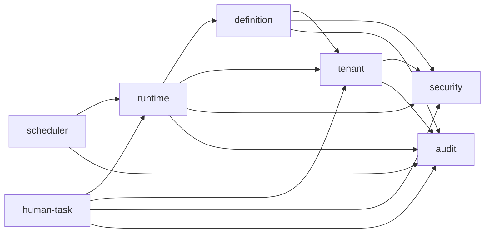

# 控制面模块边界

- 状态：Accepted
- 日期：2026-07-30
- 对应任务：G1-05
- 适用路径：`control-plane/src/main/java/com/workflowplatform/controlplane`

## 目标

控制面保持一个部署单元，但代码和数据所有权按业务能力隔离。模块只能调用目标模块根包中的公开 API，不能访问其他模块的子包、内部实现或 Repository。

这一约束由 `ControlPlaneModuleArchitectureTests` 自动执行，不依赖代码评审人员记忆。

## 模块与允许依赖

| 逻辑模块 | Java 根包 | 允许依赖 |
|---|---|---|
| `security` | `controlplane.security` | 无 |
| `audit` | `controlplane.audit` | 无 |
| `tenant` | `controlplane.tenant` | `security`、`audit` |
| `definition` | `controlplane.definition` | `tenant`、`security`、`audit` |
| `runtime` | `controlplane.runtime` | `definition`、`tenant`、`security`、`audit` |
| `scheduler` | `controlplane.scheduler` | `runtime`、`audit` |
| `human-task` | `controlplane.humantask` | `runtime`、`tenant`、`security`、`audit` |

箭头表示“编译时依赖”：



依赖图必须保持无环。若需要反向通知，优先使用模块公开事件或由上层 application service 编排，不能新增循环依赖。

## 包可见性规则

1. 模块根包是唯一跨模块公开 API，例如 `controlplane.runtime`。
2. 模块的所有子包默认视为内部实现；标准实现入口为 `controlplane.<module>.internal`。
3. 即使源代码类型声明为 `public`，位于子包中也不能被其他模块直接引用。
4. `*Repository` 永远属于声明它的模块，不允许跨模块直接调用。
5. 一个模块不得直接更新另一个模块拥有的表；后续由 Repository 与迁移归属测试继续强化。
6. `shared-contracts` 只承载跨进程稳定契约，不能用来绕过控制面内部模块边界。

## 声明方式

每个模块根包在 `package-info.java` 使用 `@ModuleBoundary`：

```java
@ModuleBoundary(
        value = "runtime",
        allowedDependencies = {"definition", "tenant", "security", "audit"})
package com.workflowplatform.controlplane.runtime;
```

内部包使用 `@ModuleInternal`。模块逻辑名称和允许依赖是架构测试的权威输入，文档表格必须与注解保持一致。

## 自动化验证

架构测试执行以下断言：

- 模块集合必须且只能是七个规定模块。
- 每个模块必须有且只有一个根包声明，并有内部实现包标记。
- 声明的允许依赖必须指向已知模块，不能自依赖，声明图必须无环。
- 实际字节码跨模块依赖必须出现在允许列表中。
- 跨模块依赖只能指向目标模块根包，不能访问任意子包。
- 任意跨模块 `*Repository` 访问都会失败。
- 实际模块字节码依赖图必须无环。
- 测试作用域包含故意创建的未声明 `tenant -> runtime` 依赖、`runtime.internal` 访问和跨模块 Repository 访问，规则必须主动拒绝这些样例，避免规则空跑。

执行命令：

```powershell
.\mvnw.cmd -B -pl control-plane -am test
```

完整项目仍以根目录 `clean verify` 作为合并门槛。
