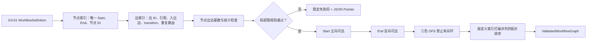

# DSL v1 工作流图校验

状态：Accepted（G3-03）  
权威机器契约：`config/dsl/graph-validation.json`  
实现模块：`control-plane` 的 `definition` 包  
输入模型：`com.workflowplatform.contracts.dsl.WorkflowDefinition`

## 1. 目标与阶段边界

G3-03 是 G3-02 安全解析和后续节点专属编译之间唯一的图语义收口点。它接收已经构造完成的 G3-01 不可变值模型，验证图的身份、引用、拓扑和 transition 语义；通过后返回不可变 `ValidatedWorkflowGraph`，供编译器使用唯一 Start、End 列表和确定性拓扑顺序。

本阶段不重新解析 JSON/YAML，不改变 canonical JSON 或 checksum，也不验证 connector/secret、节点专属参数或 CEL/JSONPath。G3-02 保持“只解析、不误判图语义”的职责；G3-04 和 G3-05 继续处理权限与表达式边界。

## 2. 分阶段校验流程



局部身份或引用错误存在时，不运行全局拓扑算法，避免悬空引用或重复节点引发级联伪错误。所有局部违规按“校验阶段、定义顺序”聚合；全局校验同样按节点或边在原定义中的顺序报告，结果不依赖 HashMap 遍历顺序。

## 3. 节点身份与终止性

- Start 必须恰好一个；零个和多个均使用 `start_node_count_invalid`。
- End 至少一个；允许多个业务结果 End，缺失时使用 `end_node_required`。
- 节点 ID 全局唯一，重复出现位置使用 `duplicate_node_id`。
- 每个节点必须能从唯一 Start 到达，否则使用 `node_unreachable`。
- 每个非 End 节点必须至少存在一条最终通向任意 End 的路径，否则使用 `node_cannot_reach_end`。

Start 的出边必须恰好一条。Condition 至少两条出边且至少一条是 `condition`；HTTP、Delay、Human Task 至少一条出边。End 必须没有出边。

## 4. 边与 transition 合法性

边 ID 必须唯一，`from` 和 `to` 必须引用现存节点。自环、指向 Start 的入边、从 End 发出的出边，以及相同 `from`/`to`/`on` 的重复路由均被拒绝。

| 源节点类型 | 允许的 transition |
|---|---|
| Start | `success`、`always` |
| End | 无 |
| HTTP | `success`、`failure`、`always` |
| Condition | `condition`、`always` |
| Delay | `success`、`failure`、`always` |
| Human Task | `success`、`failure`、`always` |

除 `condition` 分支外，同一源节点的同一 transition 最多出现一次。Condition 可声明多个条件分支和最多一个 `always` 默认分支；其他节点一旦声明 `always`，不得再与 success/failure 分支并存。这避免运行时面对多个同类候选边或无条件边与结果边重叠时产生非确定选择。

## 5. 环、可达性与复杂度

DSL v1 没有显式的循环节点、迭代上限或退出预算，因此无法证明任何循环是有界的。G3-03 对所有有向环统一返回 `cycle_not_allowed`，包括跨节点回边；自环更早以 `self_loop_not_allowed` 拒绝。将来若引入循环，必须通过新 Schema 版本和显式有界构造扩展，不能放宽 v1。

图大小沿用 G3-01 上限：最多 500 个节点、2,000 条边。索引、正向可达、反向可达、三色 DFS 和 Kahn 拓扑排序均为 `O(V+E)`；递归深度最多 500。拓扑排序在多个节点同时就绪时按节点在定义数组中的索引选择，保证相同模型产生相同编译遍历顺序。

## 6. 稳定错误契约

G3-03 固定 16 个失败码：

`start_node_count_invalid`、`end_node_required`、`duplicate_node_id`、`duplicate_edge_id`、`unknown_edge_source`、`unknown_edge_target`、`self_loop_not_allowed`、`incoming_edge_to_start`、`outgoing_edge_from_end`、`transition_not_allowed`、`duplicate_edge_route`、`outgoing_transition_ambiguous`、`outgoing_edge_count_invalid`、`node_unreachable`、`node_cannot_reach_end`、`cycle_not_allowed`。

每个 `WorkflowGraphViolation` 只保存稳定枚举和最长 128 字符的 JSON Pointer，例如 `/edges/3/to`。异常公开消息仅包含固定的 `graph_invalid` 和违规数量，不拼接节点 ID、边 ID、表达式或原始 Payload。调用方可以把 JSON Pointer 映射到表单字段，但不能把底层异常文本直接暴露给外部 API。

## 7. 不可变输出

`ValidatedWorkflowGraph` 保存原始不可变定义、唯一 Start ID、按定义顺序排列的 End ID，以及确定性的拓扑节点 ID。所有 List 在构造时复制为不可变集合；调用方不能修改验证结果。该结果只证明图语义，不代表定义已经通过 G3-04 节点权限或 G3-05 表达式编译，也不等于可发布版本。

## 8. 明确延期边界

- G3-04：六类节点和三类触发器的专属字段、connector/secret 存在性与租户授权。
- G3-05：CEL/JSONPath 语法、类型、确定性函数白名单、资源预算和沙箱。
- G3-10：跨版本属性、兼容组合和更大恶意输入全集。

## 9. 自动化验收

```powershell
pnpm dsl:g3-03:verify
pnpm dsl:g3-03:test
mvn -pl control-plane -am test
```

Java 27 项测试覆盖 3 个合法 fixture、18 类非法 fixture、500 节点最大深度，并验证 16 个稳定失败码、聚合顺序、消息脱敏、JSON Pointer、不可变结果和确定性拓扑排序。静态正反门禁锁定机器契约、Java 实现标记、fixture 集、根脚本、架构索引、追踪矩阵与本文档，防止只修改测试或文档造成能力漂移。
