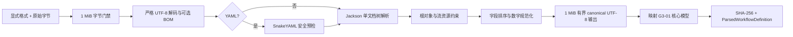

# DSL JSON/YAML 解析、规范化与 checksum

状态：Accepted（G3-02）  
权威机器契约：`config/dsl/parser-normalization.json`  
实现模块：`control-plane` 的 `definition` 包  
核心值模型：`com.workflowplatform.contracts.dsl.WorkflowDefinition`

## 1. 目标与职责

G3-02 把显式声明为 JSON 或 YAML 的工作流定义转换为同一份确定性结果：G3-01 的不可变 Java 核心模型、`workflow-canonical-json-v1` canonical JSON，以及对 canonical UTF-8 字节计算的小写 SHA-256。相同语义、不同字段顺序或 JSON/YAML 表达形式必须得到相同 checksum，供后续草稿校验、版本发布和不可变内容寻址使用。

解析器归属控制面的 `definition` 模块，因为它是定义导入与编译入口的一部分；`shared-contracts` 只保存跨模块值契约，不依赖 Jackson 或 SnakeYAML。调用方必须显式传入 `JSON` 或 `YAML`，解析器不根据内容或扩展名猜测格式。

## 2. 处理流程



先做字节级和编码级门禁，再解析单一文档；YAML 在 Jackson 读取前额外通过 SafeConstructor 预检，避免流式适配器绕过集合别名、自定义 tag 或递归键限制。canonical 输出采用边写边计数的有界缓冲区，达到上限立即终止，不会先生成任意大的字符串再检查长度。

## 3. 输入与资源上限

| 约束 | 固定值 | 失败码 |
|---|---:|---|
| 原始输入 | 1～1,048,576 bytes（1 MiB） | `empty_input` / `input_too_large` |
| 编码 | 严格 UTF-8，可有一个 UTF-8 BOM | `invalid_utf8` |
| 文档数 | 恰好 1 | `multiple_documents` |
| 根类型 | object | `root_not_object` |
| 嵌套深度 | 64 | `resource_limit_exceeded` |
| 文档字符 | 1,048,576 | `resource_limit_exceeded` |
| Token 数 | 200,000 | `resource_limit_exceeded` |
| 数字 Token 长度 | 100 | `resource_limit_exceeded` |
| 字符串长度 | 262,144 | `resource_limit_exceeded` |
| 字段名长度 | 200 | `resource_limit_exceeded` |
| canonical 输出 | 1,048,576 bytes（1 MiB） | `canonical_output_too_large` |

UTF-8 解码器对 malformed 和 unmappable 输入均使用 `REPORT`，不替换非法字节。原始长度包含 BOM，避免通过前缀绕过 1 MiB 限制。Token、深度、字符串、数字和字段名限制由 Jackson `StreamReadConstraints` 在构造完整对象树前执行。

## 4. YAML 安全边界

YAML 是 JSON 的超集，但其锚点、别名、递归结构和 tag 会扩大攻击面。G3-02 固定以下策略：

- 重复键禁止；
- 集合别名上限为 0，递归键禁止；
- 禁止 merge compose，不展开 `<<` 合并语义；
- 使用 `UnTrustedTagInspector` 和 SafeConstructor，拒绝自定义全局 tag；
- code point 上限为 1 MiB，嵌套深度为 64；
- `yes`、`no`、`on`、`off` 等 boolean-like words 按字符串解析，只有标准 `true`/`false` 表示布尔值。

安全预检和实际树解析共用同一组 LoaderOptions。集合别名造成的资源边界失败稳定映射为 `resource_limit_exceeded`；重复键、自定义 tag 等语法或结构问题映射为 `malformed_document`。对外异常消息只包含稳定失败码和可选行列号，不拼接 Payload 或第三方解析器原始消息。

## 5. canonical JSON v1

`workflow-canonical-json-v1` 的规则为：

1. 每个 object 的 key 按 Java `String` 自然序递归排序；
2. array 保持源顺序；
3. 整数和小数使用任意精度，不经过 `double`；
4. 小数去除末尾零，负零归一为 `0`；
5. 科学计数法展开为 plain decimal；
6. 输出无无关空白，编码固定为 UTF-8；
7. 不做 Unicode normalization，组合字符差异会产生不同 checksum。

plain decimal 写入器按 `BigDecimal` 的 unscaled value 与 scale 分段输出，不先调用可能产生超大临时字符串的 `toPlainString()`。它会在写零扩展前预留剩余字节预算，因此短输入（例如极大指数）不能绕过 canonical 1 MiB 限制制造内存放大。字符串按标准 JSON escaping 写入；所有源字段，包括 G3-01 核心模型暂不识别的节点专属字段，仍保留在 canonical JSON 中。

## 6. 核心模型映射

规范化树映射到 `WorkflowDefinition`：

- 根字段映射 schema/catalog version、名称、描述、触发器、节点、边、输入/输出 Schema 和 metadata；
- 节点公共字段单独映射，剩余字段进入深层不可变 `WorkflowNode.configuration`；
- 触发器 `id`/`type` 之外的字段进入 `WorkflowTrigger.configuration`；
- 边的 mapping object 已按 canonical key 排序，再转换为 `List<ParameterMapping>`；
- ISO-8601 duration 与 G3-01 构造器不变量失败统一映射为 `core_model_invalid`。

`ParsedWorkflowDefinition` 保存显式源格式、原始字节数、核心模型、canonical JSON 和 SHA-256。`canonicalBytes()` 每次返回新的 UTF-8 byte array，调用方无法修改内部结果。

## 7. 稳定失败契约

| 失败码 | 含义 |
|---|---|
| `empty_input` | 零字节或仅空白 |
| `input_too_large` | 原始字节超过 1 MiB |
| `invalid_utf8` | 严格 UTF-8 解码失败 |
| `malformed_document` | JSON/YAML 语法、重复键、tag 或不支持的结构失败 |
| `resource_limit_exceeded` | 深度、Token、字符串、数字、字段名或 YAML 别名等资源限制失败 |
| `multiple_documents` | 输入含多个 JSON 根值或 YAML 文档 |
| `root_not_object` | 唯一文档根不是 object |
| `core_model_invalid` | 无法构造 G3-01 核心模型 |
| `canonical_output_too_large` | 规范化 UTF-8 输出超过 1 MiB |

失败码可作为后续 RFC 9457 领域错误映射的内部原因，但 G3-02 本身不新增 HTTP API。异常的 `line`/`column` 为 1-based；无法可靠定位时为 0。

## 8. 明确延期边界

G3-02 只完成安全解析、确定性规范化、checksum 和 G3-01 模型绑定，不提前声称以下能力：

- G3-03：唯一 Start、节点/边 ID 唯一、边引用存在、可达性和非法环；
- G3-04：节点专属 Schema、参数类型、connector/secret 引用和权限；
- G3-05：CEL/JSONPath 语法、类型检查与资源沙箱；
- G3-10：跨版本属性测试、兼容组合和更大恶意输入语料库。

因此解析器测试会证明重复 Start 和悬空边仍可进入下一编译阶段；这不代表它们可发布，只表示图语义由 G3-03 单一收口。

## 9. 自动化验收

```powershell
pnpm dsl:g3-02:verify
pnpm dsl:g3-02:test
mvn -pl control-plane -am test
```

Java 测试覆盖 JSON/YAML 等价性、BOM、key/mapping 排序、任意精度数字、负零、checksum 防御性复制、所有资源上限、重复键、多文档、根数组、YAML 别名/递归键/tag、错误脱敏以及 G3-03 延期边界。静态正反门禁同时锁定机器契约、依赖、实现标记、fixture、根脚本、追踪矩阵与本文档。
