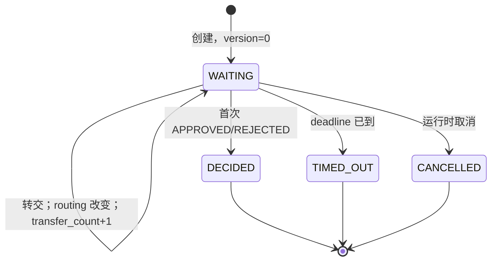

# Human Task、追加审计与配额窗口 V5 迁移

- 状态：Accepted
- 日期：2026-07-30
- 对应任务：G2-08
- Requirement：`REQ-DATA-001`、`REQ-HUMAN-001`、`REQ-SECRETS-001`、`REQ-GOV-001`
- 迁移：`control-plane/src/main/resources/db/migration/V5__create_human_audit_and_quota.sql`
- 前置版本：V4
- 校验命令：`pnpm database:g2-08:verify`、`pnpm database:g2-08:test`、`pnpm database:g2-08:integration`

V5 只追加 `human_task`、`audit_log`、`quota_usage`，不修改已冻结的 V1～V4。它完成 22 张核心表的能力级 Schema，但不把 G7 的人工任务 API、G6 的审计接入与限流策略提前声明为已实现。

## 1. 实现前复审与补强

原 ER 基线已覆盖三张表，但落库前仍有四处正确性缺口：

1. `human_task` 只有 `transfer_count`，无法证明最近一次转交的时间和主体，也没有数据库守卫阻止第二次决策或终态改写。
2. 人工超时索引以 `status` 开头，与强制 RLS 下的租户级扫描不一致。
3. `audit_log` 的 append-only 只停留在约定，trace 索引也没有以 tenant 开头；tenant 可空平台行需要独立的写入边界。
4. `quota_usage` 仅对窗口起点唯一，两个不同起点的并发窗口仍可能重叠。

因此模型升级到 `1.4.0`：补充 `last_transferred_at/by`、三类生命周期 guard、tenant-leading 索引，并用事务级 advisory lock + 区间相交检测串行化同一 tenant/resource 的窗口创建。

## 2. 表与数据库不变量

| 表 | 列 | FK | CHECK | 显式索引 | 核心不变量 |
|---|---:|---:|---:|---:|---|
| `human_task` | 22 | 2 | 7 | 4 | 同一 node 一个 task；必须引用同租户 `WAITING_APPROVAL` node；仅允许 WAITING 转交或首次终态收口 |
| `audit_log` | 15 | 1 | 6 | 3 | tenant 行或受控平台行；运行角色仅 SELECT/INSERT；UPDATE/DELETE trigger 双重阻断 |
| `quota_usage` | 12 | 1 | 4 | 2 | tenant/resource/window_start 唯一；同资源窗口不得相交；用量只增不减；窗口与 limit 快照不可改 |

合计 49 列、4 个 `ON DELETE RESTRICT` FK、17 个 CHECK、9 个显式索引、3 个 ENABLE+FORCE RLS policy 和 3 个 lifecycle guard。

## 3. Human Task 生命周期



- INSERT 必须从 `WAITING`/version 0/transfer 0 开始，并以 `FOR KEY SHARE` 确认同租户 node 当前为 `WAITING_APPROVAL`。
- WAITING→WAITING 只代表一次转交：候选角色或 assignee 必须改变，`transfer_count` 只加 1，`last_transferred_at/by` 和 `updated_by` 必须匹配。
- WAITING→DECIDED 只接受 `APPROVED`/`REJECTED`，决策主体必须与 `updated_by` 一致。
- WAITING→TIMED_OUT 必须已经到达持久化 deadline；尚未到期的写入由数据库拒绝。
- 任一终态之后拒绝 UPDATE；普通运行角色没有 DELETE 权限。

表单 Schema 必须为非空 JSON object。表单数据只保存非空受权引用 + 小写 SHA-256 摘要，二者必须同时为空或同时有效；V5 不保存明文业务表单。

## 4. 追加审计与平台行

普通租户审计 policy 为 `tenant_id = app_tenant_id()`。平台级事件只允许 `tenant_id IS NULL AND app_is_platform_admin()`；因此：

- 普通应用会话即使伪造 `actor_type=PLATFORM_ADMIN` 也不能写平台行。
- 平台管理员不设置 tenant context 时只能读写平台行，不能旁路读取租户审计。
- 平台管理员设置 tenant context 后可读取该租户行和平台行，仍不能跨到其他租户。
- `actor/action/resource/trace` 使用受控形状；before/after 只接受 JSON object，字段名明确为 digest 或 redacted。
- 运行角色仅有 SELECT/INSERT；UPDATE/DELETE 没有授权，表 owner 仍会被 append-only trigger 阻断。

数据库只能验证结构和不可改写，不能判断 JSON 内每个业务字段是否真正脱敏。G6-10 仍需通过 `AuditPort`、字段级 allowlist/denylist 和日志安全测试完成内容治理。

## 5. 配额窗口与并发边界

窗口创建先获取 `hash(tenant_id:resource_type)` 的事务级 advisory lock，再检查半开区间相交条件：

```text
existing.window_start < new.window_end
AND existing.window_end > new.window_start
```

因此相邻的 `[00:00,01:00)` 与 `[01:00,02:00)` 合法，任何实际重叠均被拒绝。更新仅允许 `used_value` 单调增加且 version 恰好 +1；tenant、resource、window、created 字段和 `limit_value` 均作为窗口快照冻结。

V5 没有实现配额 policy、拒绝阈值、退款/预留语义、分布式限流或 Worker 背压；这些仍属于 G6-09。`used_value` 可以超过 `limit_value`，以便后续策略记录超额事实，而不是由 CHECK 静默丢失用量。

## 6. 索引与权限

- inbox：`(tenant_id,assignee_subject,created_at,id)` 与 `(tenant_id,candidate_role_code,created_at,id)` 的 WAITING partial index。
- timeout：`(tenant_id,deadline_at,id)` 的 WAITING partial index。
- audit：tenant/time、tenant/resource 和 tenant/trace 稳定游标。
- quota：tenant/resource/window_end 当前窗口查询与 tenant/window_end 保留扫描。

`human_task`、`quota_usage` 向 application/platform-admin role 授予 SELECT/INSERT/UPDATE；`audit_log` 仅授予 SELECT/INSERT；三张表均不授予 DELETE。三个 trigger function 都是 `SECURITY INVOKER`、固定 `search_path`，且撤销 PUBLIC 和运行角色直接 EXECUTE。

## 7. 验收与已知边界

- 静态 verifier 锁定模型、列、FK、CHECK、索引、RLS、guard 与授权；15 类反向变异全部被拒绝。
- 真实 PostgreSQL 18.4 验证 V4→V5、重复 migrate、两租户 fixture、应用角色、迁移 owner 和平台管理员三种权限路径。
- 验证了首次转交/决策/超时、提前超时拒绝、终态不可改、平台行、跨租户隔离、相邻/重叠窗口、用量单调和 limit 快照。
- V1～V4 内容与 SHA-256 保持冻结；V5 登记 SHA-256 `803776f6bb525e4726f90d20b76f708fc6baae82aaa5f1450529b85b55e7cd50`。
- Flyway 11.7.2 对 PostgreSQL 18.4 仍输出“最新受测版本为 17”告警；兼容矩阵与升级决策留在 G2-11，不影响本次实测通过结论。

G7 仍需实现 inbox 鉴权、application service、Human Task 与 node 状态的同事务联动、事件写入、并发 API 响应和退款审批 E2E。G6 仍需实现 AuditPort 脱敏、审计查询授权、配额策略、限流和真实并发压力测试。
