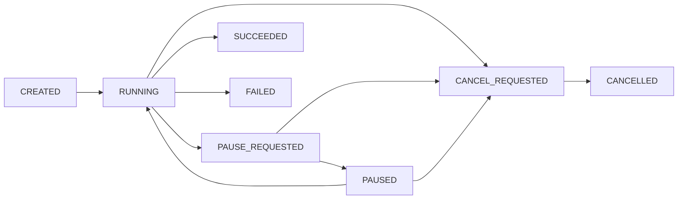

# Runtime 状态机与合法迁移矩阵

本页是 ADR-003 的可读索引，机器事实源为 [`config/runtime/state-machine.json`](../../config/runtime/state-machine.json)。G4-01 冻结状态和迁移；G4-02 已实现统一事务组件，DAG 推进、调度、Worker claim 和查询 API 按后续任务实现。

## 状态关系

Node 和 attempt 采用分层执行语义：`PENDING -> READY -> DISPATCHED -> RUNNING`，Worker 结果进入成功/失败、重试等待、定时等待、审批等待或取消；attempt 从 `RUNNING` 只能进入一个不可改写终态。每一条边都要求 expected status、expected version 和事务 Outbox。

## 实施约束

- 不允许根据 enum ordinal、字典序或空值推断迁移；
- 乐观锁条件更新必须同时比较 status/version，版本严格加一；
- terminal 无 outgoing transition，历史 attempt 不被重试覆盖；
- Worker 结果必须携带当前 lease generation/fencing token；
- 状态行、追加 audit 和 outbox event 同事务提交或回滚；
- PostgreSQL 是唯一权威，Kafka/内存/Redis 不得单独形成运行状态。

完整迁移列表、actor、guard、side effect、失败矩阵和 G4-02～G4-16 边界见 [ADR-003](../adr/ADR-003-runtime-instance-node-attempt-state-machines.md)。

生产落地、条件更新、0 行分类、RLS 与 PostgreSQL 原子性见 [Runtime 统一状态迁移事务组件](runtime-state-transition-component.md)。
