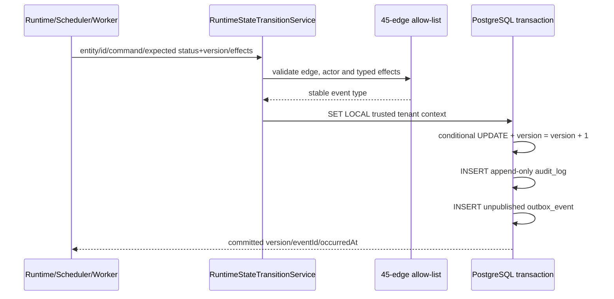

# Runtime 统一状态迁移事务组件

G4-02 将 ADR-003 和 `config/runtime/state-machine.json` 的 45 条边落成唯一生产入口 `RuntimeStateTransitionService`。组件覆盖 workflow instance、node instance、task attempt 和 schedule occurrence；调用方不能直接拼接状态 UPDATE，也不能绕开 actor/effect 校验。第 45 条为 G5-06 租约恢复所需的 `RUNNING -> READY:lease_expired`。

## 调用与事务顺序

任一 UPDATE、审计或 Outbox 写入失败都会回滚整个事务。事件与审计共用 UUIDv7 event ID；Outbox 只携带实体、迁移、版本和 reason code，不携带输入输出正文、token、Secret 或错误原文。错误摘要仅在 attempt 数据库字段保存脱敏值，在审计中只记录 SHA-256 摘要。

## 乐观锁与确定失败

每次写入固定比较 `tenant_id + id + expected status + expected version`。条件 UPDATE 为 0 行时，在同一可信 tenant context 下分类：

1. 行不可见或不存在：`NOT_FOUND`，跨租户同样不泄露存在性；
2. 当前 version 不同：`VERSION_CONFLICT`；
3. version 相同但 status 不同：`INVALID_STATE_TRANSITION`；
4. Worker status/version 相同但 worker ID、lease generation 或未过期条件不匹配：`FENCING_TOKEN_CONFLICT`。

服务在访问数据库前拒绝矩阵外边、非法 actor 和字段副作用。Node 的可调度状态必须携带 `nextScheduleAt`，派发必须携带 worker/lease，失败或重试必须携带稳定错误码；attempt 失败终态必须携带脱敏错误；schedule `FIRED` 必须绑定实例。

## 并发与恢复不变量

- 两个 writer 使用相同 expected version 时仅一个提交，另一个稳定返回 `VERSION_CONFLICT`；
- terminal 状态没有可注册的 outgoing rule，历史 attempt 不可二次修改；
- Worker claim/result 使用当前 worker ID、lease generation 和未过期租约作附加条件；
- RLS tenant context 在事务连接上设置，调用者传入的 tenant 不能作为旁路查询条件；
- PostgreSQL 是唯一状态权威，Outbox 发布由 G4-07 实现，Kafka 不能反向覆盖数据库状态；
- G4-05/G4-06/G4-09 只能调用本组件，不得复制迁移 SQL 或另建状态事实源。

## 测试边界

Java 单元测试锁定 45 条规则、稳定 event type、非法迁移/actor 和 typed effects。PostgreSQL 18.4 Testcontainers 8 个集成测试覆盖四类实体、状态/审计/Outbox 原子提交、Outbox 权限故障全回滚、同版本双 writer、fencing 冲突、独立计数增长和跨租户不披露。机器校验器再把实现、ADR、需求追踪、根门禁与验收证据绑定，防止“有代码但未接门禁”。

本步不实现触发实例创建、DAG 前驱判定、到期扫描、Outbox 发布、Kafka 消费或 Worker lease 生命周期；这些能力依次属于 G4-03～G4-09。
