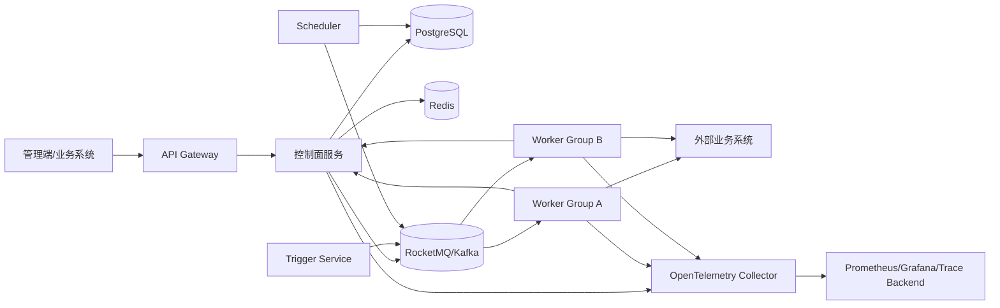

# 企业级事件驱动智能工作流平台——项目开发大纲

> 项目定位：面向企业审批、定时任务、Webhook 集成、业务补偿和跨系统自动化场景，建设一个支持可视化编排、可靠执行、多租户治理与 AI 辅助配置的工作流平台。
>
> 推荐技术路线：Java 21 + Spring Boot 3 / Go 1.24 + Kratos（二选一），PostgreSQL、Redis、RocketMQ/Kafka、OpenTelemetry、Prometheus、Grafana、Docker、Kubernetes。

## 1. 项目背景与价值

企业内部通常存在大量跨系统流程，例如订单超时关闭、退款审核、合同审批、告警处理、数据同步、定时报表和第三方 Webhook 回调。若每个业务系统分别实现调度、重试、审批、告警和补偿逻辑，会形成重复建设，并造成执行状态不可见、失败难恢复、配置难审计等问题。

本项目将这些共性能力抽象为统一的事件驱动工作流平台。业务人员负责配置流程，研发人员通过 HTTP、消息或 SDK 触发流程，平台负责可靠调度、状态持久化、失败恢复和运行观测。

项目的简历价值主要体现在：

- 既有明确的企业业务场景，又包含分布式调度、一致性、幂等和故障恢复等后端难点。
- 可以逐步完成 MVP，不要求一次实现完整 BPMN 标准。
- AI 仅用于辅助生成和解释流程，核心执行仍由可验证的规则与状态机控制。
- 可以通过压力测试、故障注入和恢复演练形成真实量化结果。

## 2. 建设目标与范围

### 2.1 核心目标

1. 支持 HTTP、消息、定时任务、人工操作四类触发方式。
2. 支持串行、并行、条件分支、延迟、人工审批和子流程节点。
3. 工作流实例状态必须持久化，服务重启后可以继续执行。
4. 节点支持超时、重试、指数退避、失败补偿和人工重放。
5. 支持多租户、RBAC、操作审计和敏感配置加密。
6. 支持运行指标、日志、链路追踪、告警和执行历史查询。
7. 支持自然语言生成流程草稿，但发布前必须经过结构校验和人工确认。

### 2.2 MVP 范围

- 租户、用户、角色和项目空间管理。
- 工作流定义、版本、发布、停用和复制。
- HTTP、定时和手动触发器。
- HTTP 调用、条件判断、延迟、人工审批和结束节点。
- Worker 拉取任务、心跳续租、执行结果上报。
- 固定间隔/指数退避重试、死信、手工重放。
- 实例列表、节点状态、输入输出、错误信息和审计记录。

### 2.3 二期范围

- Kafka/RocketMQ 事件触发器。
- 并行网关、子流程、补偿节点和回调节点。
- Webhook 签名验证、连接器市场、密钥托管。
- SLA 超时告警、运行报表和配额管理。
- 自然语言生成流程、失败原因总结、参数建议。

### 2.4 明确不做

- 第一版不完整实现 BPMN 2.0，仅实现简化 DSL。
- 不在工作流数据库中保存大文件，文件进入对象存储，只保存引用。
- 不允许 AI 直接发布流程或执行高风险操作。
- 不承诺任意外部接口的 exactly-once；平台提供至少一次投递和业务幂等能力。

## 3. 用户角色与典型场景

| 角色 | 主要职责 | 核心需求 |
|---|---|---|
| 平台管理员 | 管理租户、系统配额和全局连接器 | 资源隔离、审计、告警、容量管理 |
| 租户管理员 | 管理成员、角色和密钥 | 权限、项目空间、用量统计 |
| 流程设计者 | 创建和发布工作流 | 可视化配置、版本管理、调试 |
| 业务审批人 | 处理人工任务 | 待办、转交、加签、超时提醒 |
| 开发者 | 接入触发器和节点 | API、SDK、Webhook、幂等 |
| 运维人员 | 处理失败和系统异常 | 重放、暂停、恢复、可观测性 |

### 3.1 代表性用例

#### 用例 A：订单超时关闭

订单创建事件触发流程，延迟 30 分钟检查支付状态；未支付则调用库存服务释放库存，再调用订单服务关闭订单。任何一步失败均重试，最终失败进入人工处理队列。

#### 用例 B：退款审批与补偿

退款申请先经过规则节点判定金额。小额退款自动通过，大额退款进入人工审批；审批通过后调用支付渠道，支付渠道超时则查询结果，确认失败后执行补偿并通知客服。

#### 用例 C：告警自动化处理

监控系统发送 Webhook，流程根据服务、严重等级和环境分支处理：自动查询最近发布记录、拉取日志摘要、创建工单并通知责任人；高风险操作必须人工确认。

## 4. 功能需求

### 4.1 工作流定义

- 使用 JSON/YAML DSL 保存流程图，定义节点、边、参数映射、重试策略和超时。
- 草稿可以反复编辑；发布时生成不可变版本。
- 已运行实例始终绑定发布时的版本，后续编辑不得改变历史实例。
- 发布前执行静态校验：起点唯一、节点 ID 唯一、路径可达、参数类型正确、无非法循环、密钥引用存在。
- 支持克隆、导入导出和版本差异查看。

示例 DSL：

```yaml
name: refund-approval
version: 3
trigger:
  type: http
nodes:
  - id: risk_check
    type: condition
    expression: "input.amount <= 500"
  - id: manual_approval
    type: human_task
    assigneeRole: finance_reviewer
    timeout: 24h
  - id: refund_api
    type: http
    endpointRef: payment.refund
    retry:
      maxAttempts: 5
      strategy: exponential
edges:
  - from: risk_check
    to: refund_api
    when: true
  - from: risk_check
    to: manual_approval
    when: false
```

### 4.2 触发器

- HTTP：为已发布流程生成触发地址，支持请求签名、幂等键和调用方鉴权。
- Cron：支持时区、错过执行策略和禁止重复调度。
- 消息：订阅指定 Topic，支持 Tag/Key 过滤和消费位点记录。
- 手动：用于测试、补数据和运维重放，需要额外权限与原因记录。
- Webhook：支持 HMAC 签名、时间戳、防重放窗口和来源 IP 策略。

### 4.3 节点类型

- HTTP 节点：方法、地址引用、Header、Body 模板、超时和响应提取。
- 消息节点：向指定 Topic 发送事件，设置业务 Key 和 Header。
- 条件节点：基于安全表达式语言计算分支，禁止执行任意代码。
- 延迟节点：等待固定时间或指定业务时间。
- 人工节点：处理人、候选角色、表单、截止时间、转交和加签。
- 并行节点：创建多个分支，并配置 all/any 汇聚策略。
- 子流程节点：调用另一个已发布流程版本，支持同步或异步等待。
- 补偿节点：对应前置业务操作的撤销逻辑。

### 4.4 实例控制

- 启动、暂停、恢复、取消、终止和重放。
- 重放可从失败节点开始，也可创建全新实例，必须记录原因和操作者。
- 取消时对未开始任务直接关闭，对已运行任务发送取消标记；无法强制终止的外部调用交由幂等和状态查询处理。
- 支持业务关联 ID 查询，例如订单号、工单号或告警 ID。

## 5. 非功能需求

### 5.1 性能目标

- MVP 目标：单集群稳定调度 1,000 个短任务/秒。
- 触发 API 在无排队场景下 P95 小于 100ms。
- 调度决策与实际派发延迟 P95 小于 500ms。
- 支持至少 100 万条工作流实例历史数据的分页查询。
- 所有指标必须注明测试环境、数据规模、脚本和持续时间，不能只写峰值。

### 5.2 可用性目标

- 控制面目标可用性 99.9%。
- 调度节点无状态或采用明确的分区租约，可水平扩展。
- 任一 Worker 或调度节点退出后，未完成任务可在租约到期后重新派发。
- 数据库故障时停止生成不可持久化的新状态，避免内存状态与持久化状态分叉。

### 5.3 一致性语义

- 平台内部状态变更通过数据库事务保证原子性。
- 数据库事件与消息发布使用 Outbox，确保最终一致。
- Worker 任务采用至少一次投递，因此节点处理器必须支持幂等。
- 对外部服务不宣传 exactly-once；通过幂等键、查询确认和补偿降低重复副作用。

## 6. 总体架构



### 6.1 服务划分

| 服务 | 主要职责 | 扩展方式 |
|---|---|---|
| API Gateway | 认证、限流、路由、审计入口 | 无状态水平扩展 |
| IAM Service | 租户、用户、角色、权限、令牌 | 读多写少，缓存权限 |
| Definition Service | 流程定义、校验、版本、发布 | 无状态水平扩展 |
| Trigger Service | HTTP/Cron/消息触发及去重 | 按触发类型扩展 |
| Orchestrator | 推进实例状态机、生成待执行任务 | 按实例或分区路由 |
| Scheduler | 扫描到期任务、获取租约、派发 | 分片或数据库抢占 |
| Worker | 执行节点插件、心跳、上报结果 | 按节点类型独立扩容 |
| Human Task Service | 待办、审批、转交、SLA | 无状态水平扩展 |
| Notification Service | 邮件、短信、企微、钉钉通知 | 消息驱动扩展 |
| AI Assistant | 流程草稿生成、错误总结 | 独立部署、严格限权 |

## 7. 核心状态机设计

### 7.1 工作流实例状态

`CREATED -> RUNNING -> SUCCEEDED`

异常分支包括：

- `RUNNING -> PAUSED -> RUNNING`
- `RUNNING -> CANCELLING -> CANCELLED`
- `RUNNING -> COMPENSATING -> COMPENSATED`
- `RUNNING -> FAILED`

所有状态迁移通过带版本号的条件更新完成，例如：

```sql
UPDATE workflow_instance
SET status = :next_status, version = version + 1, updated_at = now()
WHERE id = :id AND status = :expected_status AND version = :expected_version;
```

更新行数为 0 表示状态已被其他节点推进，需要重新读取，而不是覆盖。

### 7.2 节点任务状态

`PENDING -> READY -> DISPATCHED -> RUNNING -> SUCCEEDED`

失败路径：

- 可重试：`RUNNING -> RETRY_WAIT -> READY`
- 不可重试：`RUNNING -> FAILED`
- 租约超时：`RUNNING -> READY`，attempt 加一。
- 人工取消：`PENDING/READY -> CANCELLED`。

### 7.3 租约与心跳

- Worker 获取任务时写入 `worker_id`、`lease_expire_at` 和 fencing token。
- Worker 定期心跳延长租约；数据库只接受 token 与当前任务一致的上报。
- 调度器只回收租约已过期且未完成的任务。
- 旧 Worker 即使恢复，也因为 token 过期无法覆盖新执行者的结果。

## 8. 数据模型

### 8.1 核心表

| 表名 | 关键字段 | 说明 |
|---|---|---|
| tenant | id、name、status、quota | 租户及配额 |
| user | id、tenant_id、account、status | 用户 |
| role / permission | tenant_id、code、scope | RBAC 权限 |
| workflow_definition | id、tenant_id、name、draft | 当前草稿 |
| workflow_version | definition_id、version、dsl、checksum | 不可变发布版本 |
| trigger_config | version_id、type、config_encrypted | 触发器配置 |
| workflow_instance | id、version_id、business_key、status、version | 实例主记录 |
| node_instance | instance_id、node_id、status、attempt、lease | 节点执行状态 |
| task_execution | node_instance_id、input、output、error | 每次尝试记录 |
| human_task | node_instance_id、assignee、deadline、decision | 人工待办 |
| outbox_event | aggregate_id、event_type、payload、published_at | 事务消息 |
| secret_reference | tenant_id、name、ciphertext、key_version | 密钥引用 |
| audit_log | actor、action、resource、before、after、ip | 审计记录 |

### 8.2 索引策略

- `workflow_instance(tenant_id, created_at desc, id)` 支持稳定游标分页。
- `workflow_instance(tenant_id, business_key)` 建唯一或普通索引，是否唯一由业务配置决定。
- `node_instance(status, next_schedule_at)` 用于调度扫描。
- `node_instance(worker_id, lease_expire_at)` 用于租约回收。
- `outbox_event(published_at, id)` 用于发布器扫描。
- 历史执行表按月分区；大体积输入输出进入对象存储。

## 9. API 与事件设计

### 9.1 主要 REST API

| 方法 | 路径 | 作用 |
|---|---|---|
| POST | `/api/v1/workflows` | 创建工作流草稿 |
| PUT | `/api/v1/workflows/{id}/draft` | 更新 DSL，使用 ETag 防覆盖 |
| POST | `/api/v1/workflows/{id}/validate` | 校验流程 |
| POST | `/api/v1/workflows/{id}/publish` | 发布新版本 |
| POST | `/api/v1/workflows/{id}/instances` | 手动启动实例 |
| GET | `/api/v1/instances/{id}` | 查询实例和节点状态 |
| POST | `/api/v1/instances/{id}/pause` | 暂停实例 |
| POST | `/api/v1/instances/{id}/resume` | 恢复实例 |
| POST | `/api/v1/instances/{id}/replay` | 从指定节点重放 |
| GET | `/api/v1/tasks/inbox` | 查询当前用户待办 |
| POST | `/api/v1/tasks/{id}/decisions` | 审批、拒绝或转交 |

### 9.2 接口约定

- 所有写接口接收 `Idempotency-Key`。
- 错误响应统一包含 `code`、`message`、`traceId` 和可选 `details`。
- 列表默认使用游标分页，避免大偏移量扫描。
- 更新草稿使用 ETag/If-Match 或显式版本号，防止多人编辑覆盖。
- 租户信息来自认证令牌，禁止相信客户端随意传入的 tenantId。

### 9.3 事件 Topic

| Topic | Key | 生产者 | 消费者 |
|---|---|---|---|
| `workflow.instance.events` | instanceId | Orchestrator | 报表、通知、审计 |
| `workflow.task.ready` | taskId | Scheduler | Worker |
| `workflow.task.result` | taskId | Worker | Orchestrator |
| `workflow.human.created` | taskId | Human Task | Notification |
| `workflow.deadletter` | taskId | Worker/Scheduler | 运维处理服务 |

事件 Envelope 至少包含：`eventId`、`eventType`、`occurredAt`、`tenantId`、`traceId`、`schemaVersion` 和 `payload`。

## 10. 可靠性与一致性设计

### 10.1 Outbox

实例状态更新与 Outbox 事件写入同一个数据库事务。独立 Publisher 扫描未发布事件发送到消息队列，发送成功后标记。消费者通过 `eventId` 建去重记录。

### 10.2 幂等策略

- 触发接口：`tenant_id + idempotency_key` 唯一。
- 节点调用：生成稳定 `execution_id`，向支持幂等的下游传递。
- 消费者：先检查 inbox/processed_event，再处理业务。
- 人工审批：只允许在 `WAITING_APPROVAL` 状态下首次决策成功。
- 重放：生成新的 attempt，不修改历史执行记录。

### 10.3 重试策略

- 区分可重试错误与不可重试错误。
- 网络超时、限流和临时不可用可重试；参数错误和权限错误直接失败。
- 支持固定间隔、线性和指数退避，并增加随机抖动。
- 设置最大次数和最长重试窗口，避免无限重试。
- 外部调用超时后先查询结果，再决定是否重试，减少重复副作用。

### 10.4 流量控制

- 按租户和连接器设置并发上限。
- Worker 使用本地并发池和队列长度保护。
- 对下游接口设置令牌桶限流和熔断。
- 消息积压超过阈值时停止低优先级任务或动态扩容 Worker。

## 11. AI 辅助功能设计

### 11.1 自然语言生成流程草稿

输入示例：“订单创建 30 分钟未支付就释放库存并关闭订单，失败通知客服。”

实现流程：

1. 读取当前租户允许使用的节点目录和参数 Schema。
2. 大模型只输出满足 JSON Schema 的 DSL 草稿。
3. 服务端执行结构校验、表达式校验、权限校验和风险扫描。
4. 前端展示生成结果、假设和待补充字段。
5. 用户补全密钥引用和业务参数后人工发布。

### 11.2 失败总结

- 输入仅包含脱敏后的节点配置、错误栈摘要、重试历史和相关指标。
- 输出包括可能原因、已尝试步骤、建议动作和证据链接。
- AI 不得直接执行重放、取消或修改流程。

### 11.3 安全边界

- Prompt 中不直接传递明文密钥、完整个人信息和未授权业务数据。
- 模型调用记录租户、模型、Token、延迟和脱敏后的审计信息。
- 高风险节点由确定性的规则引擎和人工审批控制。
- 所有 AI 产物标记为“建议”，保留用户最终决策记录。

## 12. 安全设计

- OAuth2/OIDC 登录，短期 Access Token + 可撤销 Refresh Token。
- RBAC 权限至少覆盖定义查看、编辑、发布、执行、重放、密钥管理和审计查看。
- PostgreSQL 每条业务记录都带 tenant_id；Repository 层强制租户条件，可选启用 Row Level Security。
- 密钥采用信封加密；主密钥位于 KMS/Vault，数据库只存密文和 key version。
- Webhook 使用 HMAC、时间戳和 nonce，拒绝超出时间窗口的请求。
- HTTP 节点防 SSRF：域名白名单、DNS 重绑定防护、禁止访问元数据地址和内网保留地址。
- 审计日志追加写入，记录配置变更前后值；敏感字段仅记录摘要。

## 13. 可观测性与告警

### 13.1 指标

- `workflow_instances_started_total{tenant,workflow}`
- `workflow_instances_completed_total{status}`
- `workflow_task_duration_seconds{node_type}`
- `workflow_task_retry_total{reason}`
- `workflow_scheduler_lag_seconds`
- `workflow_ready_queue_depth`
- `workflow_worker_lease_expired_total`
- `workflow_deadletter_total{tenant}`

### 13.2 Trace

- 触发请求创建根 Span。
- 工作流实例、节点和每次 attempt 建立关联 Span。
- Trace Context 通过消息 Header 传播。
- 外部 HTTP、数据库和 MQ 调用自动采集，业务关键字段只记录不可逆摘要。

### 13.3 告警

- 调度延迟持续超阈值。
- Ready 队列或死信数量快速增长。
- 某连接器错误率、P99 延迟异常。
- Worker 心跳数量骤降。
- Outbox 长时间未发布。
- 租户用量超过配额或出现异常爆发流量。

## 14. 测试方案

### 14.1 单元测试

- DSL 解析、图合法性、状态机迁移和表达式求值。
- 重试时间计算、租约回收和权限判断。
- 参数模板、脱敏和签名算法。

### 14.2 集成测试

- 使用 Testcontainers 启动 PostgreSQL、Redis 和消息队列。
- 验证事务提交后事件最终发布。
- 验证消费者重复收到相同事件时结果不重复。
- 验证服务重启后延迟任务和人工任务仍能恢复。

### 14.3 端到端测试

- 订单超时、退款审批和告警处理三个完整流程。
- 模拟外部接口超时、返回 429、断开连接和响应重复。
- 验证暂停、恢复、取消、重放和版本隔离。

### 14.4 故障注入

- Worker 执行中被强制关闭，验证租约到期后重新执行。
- 消息发送成功但 Publisher 未标记，验证重复发布可去重。
- 数据库短时不可用，验证不会产生未持久化的幽灵任务。
- 消息积压，验证背压与扩容策略。

### 14.5 压力测试

- 使用 k6/Gatling 模拟触发流量。
- 分别测试短任务、长任务、延迟任务和高失败率任务。
- 输出吞吐量、P50/P95/P99、错误率、调度延迟、CPU、内存、数据库 TPS 和 MQ 积压。
- 至少持续运行 30 分钟并增加一次峰值流量，避免只记录瞬时结果。

## 15. 部署与交付

### 15.1 本地环境

- Docker Compose 启动数据库、Redis、消息队列、对象存储和可观测组件。
- 提供一键初始化脚本、演示租户和三条示例工作流。
- 配置通过环境变量或配置中心注入，仓库中不提交真实密钥。

### 15.2 Kubernetes

- API、控制面、调度器和各 Worker 独立 Deployment。
- Worker 根据队列积压或自定义指标进行 HPA/KEDA 扩容。
- PodDisruptionBudget 保护关键控制面。
- 数据库和消息队列开发环境可容器化，生产设计文档建议使用托管或高可用集群。
- 使用 Helm/Kustomize 管理环境差异。

### 15.3 CI/CD

1. 代码格式与静态检查。
2. 单元测试、集成测试、数据库迁移校验。
3. 依赖漏洞和镜像扫描。
4. 构建带 Git SHA 的不可变镜像。
5. 部署测试环境并运行端到端测试。
6. 手动批准后灰度发布，异常时自动停止扩大流量。

## 16. 开发里程碑

| 阶段 | 周期 | 交付内容 | 验收标准 |
|---|---:|---|---|
| 第 1 阶段 | 1 周 | 需求、架构、DSL、数据库设计 | 完成 ADR 和接口草案 |
| 第 2 阶段 | 2 周 | 定义、版本、HTTP/手动触发 | 可发布并启动简单流程 |
| 第 3 阶段 | 2 周 | 调度器、Worker、状态机、租约 | Worker 故障后任务可恢复 |
| 第 4 阶段 | 2 周 | 重试、Outbox、幂等、死信、重放 | 故障测试通过 |
| 第 5 阶段 | 2 周 | 人工审批、通知、多租户和 RBAC | 完成退款审批示例 |
| 第 6 阶段 | 1 周 | 监控、Trace、告警、压测 | 输出性能报告 |
| 第 7 阶段 | 1 周 | AI 草稿生成、文档、演示 | AI 输出可校验且不能直接发布 |

个人开发可压缩为 8～10 周，先完成后端和简单管理页面，不必追求复杂拖拽画布。

## 17. 项目目录建议

```text
workflow-platform/
├─ api/                 # OpenAPI/Proto 定义
├─ services/
│  ├─ gateway/
│  ├─ iam/
│  ├─ definition/
│  ├─ orchestrator/
│  ├─ scheduler/
│  ├─ human-task/
│  └─ notification/
├─ workers/
│  ├─ http-worker/
│  ├─ message-worker/
│  └─ ai-worker/
├─ libs/                # 状态机、事件、权限等共享库
├─ migrations/
├─ deploy/
│  ├─ compose/
│  ├─ helm/
│  └─ observability/
├─ tests/
│  ├─ integration/
│  ├─ e2e/
│  └─ performance/
└─ docs/
   ├─ architecture/
   ├─ adr/
   ├─ api/
   └─ runbook/
```

## 18. 最终交付物

- 可运行源码、数据库迁移和种子数据。
- Docker Compose 与 Kubernetes/Helm 部署文件。
- OpenAPI 文档、事件 Schema 和 SDK 示例。
- 架构图、状态机图、ER 图和至少 5 份 ADR。
- 三条完整演示流程及演示视频。
- 单元、集成、端到端和故障注入测试。
- 压力测试报告、监控 Dashboard 和故障处理 Runbook。
- 安全说明、权限矩阵、威胁模型和数据脱敏策略。

## 19. 主要风险与应对

| 风险 | 表现 | 应对策略 |
|---|---|---|
| 范围失控 | 节点类型和画布开发耗时过大 | MVP 仅保留 5～6 种节点，先用表单编辑器 |
| 重复执行 | Worker 超时后任务被再次领取 | 幂等键、fencing token、结果查询与补偿 |
| 历史数据膨胀 | 输入输出和日志占用数据库 | 分区、归档、对象存储和保留策略 |
| 表达式安全 | 用户表达式执行任意代码 | 使用受限 DSL，禁止系统调用和反射 |
| AI 幻觉 | 生成不存在的节点或参数 | Schema 约束、静态校验、人工发布 |
| 多租户越权 | 查询遗漏 tenant_id | Repository 强制过滤、RLS、越权测试 |

## 20. 可写入简历的成果表达

只有完成并验证后再填写真实数字：

- 设计事件驱动工作流执行引擎，基于持久化状态机、任务租约和 fencing token 实现 Worker 故障转移与过期结果隔离。
- 使用 Outbox、消费者去重表和业务幂等键保证状态变更与消息发布最终一致，覆盖消息重复、服务重启和网络超时场景。
- 实现 HTTP、定时、人工审批、条件分支及补偿节点，支持流程版本隔离、失败重放和全链路审计。
- 在 `[测试环境]` 下完成 `[持续时间]` 压测，达到 `[吞吐量]`，P99 调度延迟为 `[真实数据]`，并通过故障注入验证任务恢复。

## 21. GitHub 开源参考

### 21.1 工作流与可靠执行

1. [Temporal](https://github.com/temporalio/temporal)  
   重点参考：持久化执行、Workflow/Activity 抽象、失败恢复、重试语义。不要照搬其全部历史模型，个人项目实现核心状态机即可。

2. [Kestra](https://github.com/kestra-io/kestra)  
   重点参考：声明式流程、任务插件、执行界面、事件触发和可观测性。

3. [Apache DolphinScheduler](https://github.com/apache/dolphinscheduler)  
   重点参考：DAG 调度、Master/Worker、任务容错、资源与租户管理。

4. [Netflix Conductor 社区版](https://github.com/conductor-oss/conductor)  
   重点参考：任务队列、Worker 模式、工作流定义和微服务编排。

### 21.2 自动化与连接器

5. [n8n](https://github.com/n8n-io/n8n)  
   重点参考：节点式自动化、连接器配置、凭证管理和流程编辑体验。注意其许可证，参考设计前应阅读仓库许可说明。

6. [Node-RED](https://github.com/node-red/node-red)  
   重点参考：可视化节点、消息流模型、节点扩展机制。

### 21.3 微服务与基础设施

7. [CloudWeGo Kitex](https://github.com/cloudwego/kitex)  
   Go 路线可参考 RPC、服务治理、负载均衡、熔断、限流和 Trace 集成。

8. [Kratos](https://github.com/go-kratos/kratos)  
   Go 路线可参考 transport、middleware、registry、configuration 和代码生成。

9. [Apache RocketMQ](https://github.com/apache/rocketmq)  
   参考可靠消息、重试、顺序消息、事务消息、延迟消息与消费进度。

10. [OpenTelemetry Collector](https://github.com/open-telemetry/opentelemetry-collector)  
    参考遥测数据接收、处理、导出和组件化设计。

## 22. 推荐阅读顺序

1. 先运行 Temporal 或 Conductor 示例，理解 Workflow 与 Activity 的边界。
2. 阅读 DolphinScheduler 的 Master/Worker 与容错设计。
3. 查看 n8n/Node-RED 的节点配置方式，但不要优先投入复杂前端画布。
4. 完成自己的状态机、租约、Outbox 和幂等测试。
5. 最后增加 AI 草稿生成与错误总结，确保 AI 不进入核心执行可信边界。

