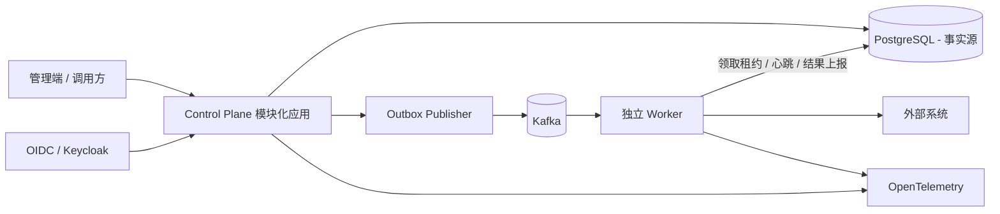

# 企业级事件驱动智能工作流平台——项目大纲审计与优化基线

> 审计日期：2026-07-30  
> 原始大纲：`C:\Users\Administrator\Desktop\01-企业级事件驱动智能工作流平台-项目开发大纲.md`  
> 当前状态：审计完成，作为开发基线 v1.0  
> 默认技术路线：Java 21 + Spring Boot 3.x；正式版本号在项目初始化时由构建文件和锁文件固定

## 1. 审计结论

原大纲的业务定位、可靠性目标和简历价值都比较完整，尤其是持久化状态机、租约、fencing token、Outbox、幂等、故障注入与 AI 安全边界，方向正确。

目前最大的风险不是功能缺失，而是“产品终态设计”与“个人可落地 MVP”混在同一份大纲里。若直接按原服务列表开工，容易先花大量时间搭微服务、网关、注册发现和部署设施，却迟迟不能跑通一条可靠流程。因此本基线将开发顺序调整为：先验证执行内核，再补治理能力，最后拆分和扩展。

## 2. 关键痛点与修订方案

| 编号 | 级别 | 痛点 | 影响 | 修订方案 |
|---|---|---|---|---|
| A-01 | P0 | MVP 一开始拆分 8～10 个服务 | 本地联调、事务边界、部署与排错成本过高 | 先做模块化单体控制面，Scheduler/Outbox Publisher 可同进程部署；Worker 独立进程。包边界和事件契约保持可拆分 |
| A-02 | P0 | Orchestrator、Scheduler、Worker 的任务领取模型不统一 | 容易出现数据库状态和 MQ 消息相互覆盖、幽灵任务或重复执行 | PostgreSQL 为唯一事实源；状态更新与 Outbox 同事务；Kafka 只负责通知/派发；Worker 消费后必须在数据库成功领取租约才能执行 |
| A-03 | P0 | 实例和节点状态不够完整 | 延迟、审批、暂停、取消、派发与恢复难以精确定义 | 增加 `WAITING_TIMER`、`WAITING_APPROVAL`、`CANCEL_REQUESTED` 等状态；用显式状态迁移表和乐观锁校验 |
| A-04 | P0 | 租约超时直接增加 attempt | Worker 未真正开始也会耗尽业务重试次数 | 分离 `dispatch_count`、`attempt_no` 和 `lease_generation`；只有真正开始的业务执行才形成 attempt |
| A-05 | P0 | 幂等键范围过粗，未定义同键不同请求的处理 | 不同接口或不同流程可能错误冲突 | 唯一键改为 `tenant + operation/resource + key`；保存请求摘要和首次响应；同键不同摘要返回冲突 |
| A-06 | P0 | DSL 只给了样例，缺少确定性和演进规则 | 历史版本可能因解析器或表达式升级而改变行为 | DSL 带 `schemaVersion`；发布时规范化 JSON、计算 checksum、锁定节点类型版本和子流程版本；禁用隐式当前时间/随机数 |
| A-07 | P0 | 条件表达式与模板引擎未选定 | 直接使用 SpEL/Javascript 有任意代码执行风险 | 条件表达式优先采用 CEL 子集；参数提取采用受限 JSONPath；模板仅允许白名单函数、大小限制和超时 |
| A-08 | P0 | SSRF 只有原则，没有解析与执行策略 | HTTP Worker 可成为内网探测或云元数据攻击入口 | 连接器使用受管 endpoint；解析 DNS 后校验全部 IP；禁止私网/环回/链路本地/元数据地址；重定向逐跳复检；限制响应大小 |
| A-09 | P1 | Cron 未定义 DST、误触发和积压策略 | 夏令时切换或停机恢复时可能重复/漏跑 | 每个触发器显式时区；记录 schedule occurrence；支持 `SKIP`、`FIRE_ONCE`、`CATCH_UP_LIMITED`；occurrence 唯一约束防重 |
| A-10 | P1 | 指标标签包含 tenant/workflow | Prometheus 高基数导致内存膨胀 | 公共指标只使用状态、节点类型、错误类别等低基数标签；租户/流程维度通过日志、Trace 或报表库查询 |
| A-11 | P1 | 数据模型缺少多个可靠性与治理实体 | 后期补表会反复改接口和事务 | 增加 project、membership、role_binding、idempotency_record、processed_event、schedule_occurrence、connector、dead_letter、worker_lease、quota_usage 等实体 |
| A-12 | P1 | 1000 短任务/秒缺少测试口径 | 数字无法复现，也可能与 MVP 资源不匹配 | 固定硬件、Payload、节点类型、下游延迟、并发、持续时间和冷/热数据集；先通过正确性门槛，再做容量优化 |
| A-13 | P1 | 多租户只依赖 Repository 约定 | 一次漏写 tenant 条件即可越权 | 请求入口建立 tenant context；Repository 强制过滤；关键表启用 PostgreSQL RLS；编写跨租户负向测试 |
| A-14 | P1 | 缺少升级、备份、恢复和数据保留设计 | 能运行但不可运维 | 数据库迁移前向兼容；定义 RPO/RTO；做备份恢复演练；输入输出、执行历史、审计分别设置保留与归档策略 |
| A-15 | P1 | AI 功能没有成本、注入和质量评估机制 | 可能产生越权数据泄露、费用失控和不可度量结果 | 增加模型供应商抽象、租户预算、Prompt 注入隔离、结构化输出评测集、人工采纳率和失败率指标 |
| A-16 | P1 | 前端范围不清晰 | 易把大量时间消耗在拖拽画布 | MVP 使用表单 + JSON/YAML 编辑 + 简单 DAG 预览；复杂拖拽编辑器放到二期 |
| A-17 | P1 | 缺少 API/Event 兼容性规则 | Worker 与控制面升级时容易互不兼容 | OpenAPI 与 JSON Schema 契约优先；事件 Envelope 版本化；消费者忽略未知字段；建立契约测试 |
| A-18 | P2 | 审计日志仅描述追加写 | 管理员修改数据库后无法察觉 | MVP 使用数据库权限隔离和 append-only 触发器；后续可增加哈希链或外部不可变存储 |

级别说明：P0 为动工前必须修订，P1 为 MVP 发布前必须落实，P2 为增强项。

## 3. 修订后的 MVP 架构

### 3.1 部署单元

1. `control-plane`：IAM 适配、租户/项目、定义、触发、编排、调度、人工任务、审计和运维 API。内部按模块隔离，禁止跨模块直接访问对方表。
2. `worker`：消费任务事件、数据库领取租约、执行 HTTP/条件/延迟收敛等节点、心跳与结果上报。节点执行器使用插件接口。
3. `web-console`：流程定义、版本发布、实例详情、人工待办、失败重放和审计查看。
4. 基础设施：PostgreSQL、Kafka、Redis（限流/短期缓存，不能保存核心状态）、MinIO（大 Payload/附件）、Keycloak、OpenTelemetry Collector。

只有在压测或组织边界证明有必要时，才把 Scheduler、Human Task、IAM 等模块拆成独立服务。

### 3.2 推荐工程技术栈

| 层次 | 推荐选择 | 说明 |
|---|---|---|
| 后端 | Java 21、Spring Boot 3.x、Maven 多模块 | 企业生态成熟，便于展示事务、Security、Kafka、Telemetry 与 Testcontainers |
| 数据 | PostgreSQL、Flyway | 核心状态唯一事实源，迁移脚本纳入版本管理 |
| 消息 | Kafka（KRaft） | 通过 Outbox 发布；不把 MQ 当数据库使用 |
| 缓存/限流 | Redis | 可降级组件，不承载实例真相 |
| 对象存储 | MinIO/S3 接口 | 存放大输入输出和附件，数据库保存摘要与引用 |
| 前端 | TypeScript、React、Vite、Ant Design | MVP 先做表单编辑器和 DAG 只读预览 |
| 契约 | OpenAPI 3.1、JSON Schema | API、DSL 和事件均契约优先 |
| 表达式 | CEL 子集 + 受限 JSONPath | 禁止执行任意代码 |
| 测试 | JUnit 5、Testcontainers、WireMock、Playwright、k6 | 覆盖并发、故障、端到端和性能 |
| 观测 | OpenTelemetry、Prometheus、Grafana、Loki/Tempo | 指标严格限制标签基数 |

## 4. 修订后的核心语义

### 4.1 实例状态

`CREATED -> RUNNING -> SUCCEEDED | FAILED`

控制分支：

- `RUNNING -> PAUSE_REQUESTED -> PAUSED -> RUNNING`
- `RUNNING/PAUSED -> CANCEL_REQUESTED -> CANCELLED`
- 二期补偿：`RUNNING -> COMPENSATING -> COMPENSATED | COMPENSATION_FAILED`

终态不可逆。每次迁移都校验 `expected_status + version`，并在同一事务中写审计记录与 Outbox。

### 4.2 节点状态

`PENDING -> READY -> DISPATCHED -> RUNNING -> SUCCEEDED`

等待与异常分支：

- 延迟：`PENDING -> WAITING_TIMER -> READY`
- 人工审批：`PENDING -> WAITING_APPROVAL -> SUCCEEDED | FAILED`
- 可重试失败：`RUNNING -> RETRY_WAIT -> READY`
- 不可重试失败：`RUNNING -> FAILED`
- 取消：非终态节点可进入 `CANCELLED`
- 租约过期：`DISPATCHED/RUNNING -> READY`，生成新 `lease_generation`；是否增加业务 attempt 取决于是否已记录执行开始

### 4.3 一致性不变量

1. PostgreSQL 中的实例、节点和 attempt 是权威状态，MQ 消息仅表示“可能有工作可取”。
2. Worker 只有以当前 fencing token 成功更新数据库，结果才有效。
3. 节点成功结果不可被迟到的失败结果覆盖。
4. 发布版本不可变；实例永久绑定准确的版本和节点执行器版本。
5. 同一幂等键与同一请求摘要返回首次结果；同键不同摘要必须报冲突。
6. 所有可能产生外部副作用的节点都获得稳定 execution id，并向支持幂等的下游透传。

## 5. MVP 范围重新分层

### 5.1 MVP 必须完成

- OIDC 登录、租户/项目成员关系、最小 RBAC 与跨租户隔离。
- DSL 草稿、静态校验、不可变发布版本、ETag 并发控制。
- 手动、HTTP、Cron 三种触发器。
- Start、End、HTTP、Condition、Delay、Human Task 六类节点。
- 持久化状态机、Outbox、Kafka 派发、租约/心跳/fencing、重试、死信和重放。
- 暂停、恢复、取消、实例与 attempt 查询。
- 管理页面：定义/发布、实例详情、人工待办、失败运维。
- 审计、密钥引用、HTTP 出站安全、基础限流与配额。
- 指标、结构化日志、Trace、Dashboard、告警和 Runbook。
- 单元、集成、端到端、租户隔离、并发竞争、故障注入和可复现压测。

### 5.2 二期再做

- Kafka/RocketMQ 入站消息触发器、完整 Webhook 管理。
- 并行网关、子流程、补偿、回调和消息发送节点。
- 拖拽画布、连接器市场、通知渠道、SLA 报表和复杂配额。
- AI 流程草稿、失败总结和参数建议。
- 按容量或团队边界拆分微服务。

### 5.3 明确不做

- 完整 BPMN 2.0、任意脚本节点、核心状态保存在 Redis、对外承诺 exactly-once。
- AI 自动发布、自动重放、自动执行高风险节点。
- 未经测量就声明吞吐量或高可用等级。

## 6. MVP 验收门槛

只有以下条件全部满足，才标记 MVP 完成：

1. 三条示例流程可以从干净环境一键启动并完整演示。
2. Worker 执行中被终止后，任务能在租约到期后由新 Worker 恢复，旧结果不能覆盖新结果。
3. Outbox 重复发送、Kafka 重复消费、HTTP 重复触发均不会造成平台状态重复推进。
4. 服务重启后 Delay、Cron 和 Human Task 不丢失。
5. 跨租户读取、修改、重放和密钥引用测试全部被拒绝。
6. HTTP Worker 无法访问环回、私网、链路本地和云元数据地址，重定向也受检查。
7. 日志、Trace、审计和错误响应不出现明文密钥或敏感 Payload。
8. 压测报告包含环境、数据、脚本、持续时间及 P50/P95/P99；不以单次峰值作为结论。
9. 数据库备份可恢复，迁移能从前一发布版本安全升级。
10. OpenAPI、DSL Schema、事件 Schema、ADR、Runbook 与实际实现一致。

## 7. 变更控制规则

- 本文是架构基线；具体进度只在《项目开发总控清单》中维护。
- 任何新需求先分为 MVP、二期或不做，再进入任务清单，不能直接插入正在执行的步骤。
- 影响数据一致性、安全边界、公开 API 或部署拓扑的决策必须新增 ADR。
- 任务只有在验收命令、测试报告或可复现演示存在时才能标为完成。
